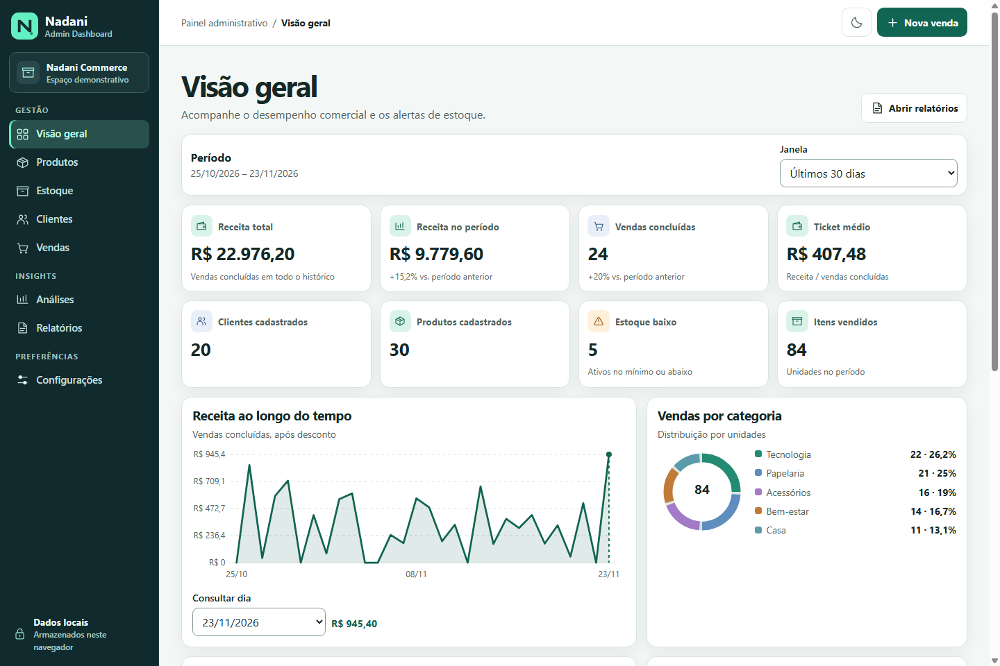
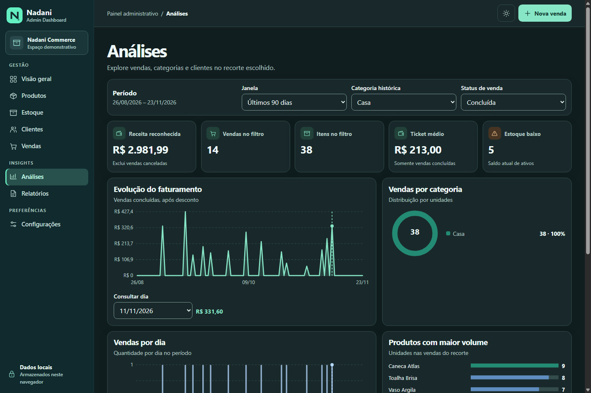

# Nadani Admin Dashboard

Painel administrativo da **Nadani Commerce**, empresa fictícia criada para uma demonstração de portfólio da Nadani Productions. O aplicativo apresenta um fluxo comercial completo, do cadastro de produtos e clientes ao registro de vendas, à conciliação do estoque e à emissão de relatórios.

## Capturas

| Visão geral no tema claro | Análises no tema escuro |
| --- | --- |
| [](docs/screenshots/dashboard.png) | [](docs/screenshots/analises.png) |

[Visão geral em 375 px](docs/screenshots/mobile.png). As capturas foram feitas no Chrome com o conjunto sintético carregado pelo próprio app.

## Execução local

Com Node.js 22 ou superior, abra um terminal na pasta do projeto e execute:

```sh
npm start
```

Abra `http://127.0.0.1:4176/nadani-admin-dashboard/`. O servidor incluído simula o caminho do repositório publicado no GitHub Pages. O projeto dispensa instalação de dependências e etapa de build. Acesse por HTTP local ou HTTPS para carregar os módulos e utilizar o armazenamento do navegador.

## Como usar

1. Em **Visão geral**, escolha **Carregar demonstração** ou **Começar vazio**. O exemplo inclui 30 produtos, 20 clientes, 60 vendas distribuídas por datas, cancelamentos e movimentações conciliadas. Cadastros e contatos são sintéticos. A demonstração usa o domínio reservado `example.invalid`.
2. Em **Produtos**, cadastre nome, SKU, categoria, preço, custo opcional e estoque mínimo. O saldo inicial gera uma entrada. Use filtros, pesquisa, ordenação e seleção para examinar o catálogo. Abra **Detalhes** para editar, arquivar, reativar ou excluir quando permitido.
3. Em **Estoque**, registre uma entrada, saída ou ajuste para um novo saldo. Consulte alertas e filtre o histórico por período, tipo ou produto. A estimativa financeira do estoque usa custo cadastrado. O indicador de estoque baixo considera ativos com saldo no mínimo ou abaixo, incluindo saldo zero.
4. Em **Clientes**, cadastre dados opcionais, pesquise por nome, e-mail ou telefone e consulte o histórico de compras. A exclusão fica disponível para cadastros sem histórico. Arquive registros vinculados para preservar as referências.
5. Em **Vendas**, selecione o cliente ou venda avulsa, adicione itens e informe quantidades e desconto em BRL. O total é exibido antes de confirmar. O cancelamento preserva a venda, registra o motivo opcional e devolve as unidades ao estoque. O comprovante tem identificação de **sem validade fiscal**. O diálogo do navegador permite imprimir ou salvar em PDF quando disponível.
6. Em **Visão geral** e **Análises**, consulte métricas, séries de receita e vendas, distribuição por categoria e rankings. Escolha 7, 30 ou 90 dias, ou um período de até 366 dias. Os gráficos de tempo permitem selecionar um dia pelo gráfico ou pelo campo de seleção.
7. Em **Relatórios**, escolha produtos, estoque, clientes, vendas ou movimentações. Os filtros alimentam a prévia e a exportação completa, que inclui registros de todas as páginas após o filtro. Há opções de CSV, JSON e impressão. O CSV usa UTF-8 com BOM, delimitador ponto e vírgula, aspas escapadas e neutralização de texto que poderia iniciar fórmulas.
8. Em **Configurações**, personalize o nome da empresa, o tema, a densidade e o tamanho de página. Exporte ou restaure um backup completo. Restaurar a demonstração, importar backup e apagar dados exigem confirmação antes da substituição.

## Regras e persistência

- Dinheiro é armazenado em centavos inteiros. Digite preços em reais sem separador de milhares. O desconto é distribuído aos itens de forma determinística, com soma exata dos centavos.
- A receita e o ticket médio excluem cancelamentos. O filtro por categoria considera a categoria registrada no item na data da venda e a parcela líquida correspondente. O relatório de vendas mostra o total histórico e a receita reconhecida separadamente.
- Produtos com movimentações ou vendas e clientes com vendas associadas ficam disponíveis para arquivamento. A venda mantém nome do cliente e snapshots de nome, SKU, categoria e preço dos itens.
- Uma transação IndexedDB lê o estado atual, aplica o comando, valida o resultado e grava venda, itens, saldo e movimentações juntos. Se a transação falhar, o estado anterior é preservado. Transações de escrita serializam gravações entre abas. `BroadcastChannel` atualiza outras abas quando disponível, e formulários de cadastro e movimento verificam se o registro mudou.
- O backup JSON é versionado. Na restauração, a aplicação valida estrutura, IDs, SKUs, referências, totais, vendas, saídas, estornos e saldo final obtido pela conciliação do histórico. Um backup inválido deixa os dados existentes intactos. Se a base local estiver ilegível, a interface oferece baixar a cópia original antes de recuperar o painel.

## Arquitetura

HTML5, CSS Grid e Flexbox, JavaScript ES6+ em módulos, IndexedDB e gráficos SVG nativos. A lógica de negócios opera sobre dados e pode ser testada sem DOM. Os nomes, os campos, a origem e os valores vindos de cadastros ou backups são renderizados como texto. O projeto usa recursos locais e dispensa bibliotecas de terceiros. O código e os ícones originais têm [licença MIT](LICENSE).

```text
nadani-admin-dashboard/
├── index.html
├── css/main.css
├── assets/               # Marca e ícones SVG
├── js/
│   ├── app.js            # Navegação, estado da interface e coordenação
│   ├── model.js          # Campos, limites, moeda e datas
│   ├── business.js       # Cadastros, movimentos, venda e estorno
│   ├── storage.js        # Transações IndexedDB
│   ├── backup.js         # Validação e conciliação do backup
│   ├── analytics.js      # Períodos e métricas
│   ├── reports.js        # Dados dos relatórios e exportação
│   ├── records.js        # Produtos, estoque, clientes e vendas
│   ├── forms.js          # Formulários, modais e comprovantes
│   ├── dashboard.js      # Painel e gráficos SVG
│   ├── admin.js          # Relatórios e configurações
│   └── demo.js, ui.js
├── docs/screenshots/
├── tests/
├── tools/serve.mjs
├── package.json
├── README.md
└── LICENSE
```

## Testes

```sh
npm test
npm run test:browser
npm run test:browser -- --screenshots
```

A suíte unitária usa `node:test`. A suíte de interface abre Chrome, Chromium ou Edge em modo headless via DevTools. Use `BROWSER_PATH` se o executável estiver em outro local.

- **20 testes unitários passaram em Node.js 24.15.0.** Cobrem cadastro, SKU único, edição, arquivamento, estoque, clientes, valores monetários, venda, cancelamento, métricas, CSV e conciliação do backup.
- **A suíte de integração no Chrome headless passou.** Verificou o fluxo de cadastro, venda, saldo, cancelamento e retorno ao estoque. Também verificou teclado e restauração de foco, gráficos, pesquisa, filtros, tema após recarga e geração de um comprovante em PDF pelo Chrome.
- **Persistência e relatórios.** Foram verificados downloads reais de CSV, JSON e backup, limpeza e restauração, recusa de backup inválido, rollback quando a gravação falha e concorrência entre duas conexões IndexedDB.
- **Responsividade.** As oito áreas e o modal de venda foram testados em 320, 375, 430, 768, 1024 e 1440 px. A suíte verificou a ausência de rolagem horizontal no layout principal e terminou sem erros HTTP ou de console observados.

## Privacidade e limitações

O painel é uma demonstração local, sem autenticação, processamento de pagamentos, documentos fiscais ou sincronização em nuvem. Os dados ficam no navegador e no perfil que os criou. Cotas, limpeza de dados e disponibilidade de impressão dependem do navegador. Use dados fictícios nas demonstrações e guarde um backup antes de trocar de dispositivo ou limpar os dados do navegador.

A conciliação trabalha sobre um snapshot único, adequado a este projeto de portfólio. Limites de cadastros e movimentações ficam em `js/model.js`. Dispositivos físicos, leitores de tela e motores de navegador diferentes do Chrome ficaram pendentes.

## Publicação no GitHub Pages

1. Quando autorizado, crie o repositório público `nadani-admin-dashboard` e envie os arquivos para a branch `main`.
2. No repositório, abra **Settings → Pages**. Em **Build and deployment**, escolha **Deploy from a branch**, selecione **main** e **/(root)** e salve.
3. Abra o endereço mostrado pelo Pages e teste a inicialização do IndexedDB. A URL padrão é `https://<usuário>.github.io/nadani-admin-dashboard/`.

As rotas usam fragmentos. Caminhos relativos e `.nojekyll` permitem servir a aplicação em subdiretório. [Documentação oficial do GitHub Pages](https://docs.github.com/en/pages/getting-started-with-github-pages/configuring-a-publishing-source-for-your-github-pages-site)

### Descrição do repositório

> Professional business management dashboard built with JavaScript, featuring inventory control, customer management, sales analytics and interactive reports.

[Developed by Nadani Productions](https://nadani.space)
